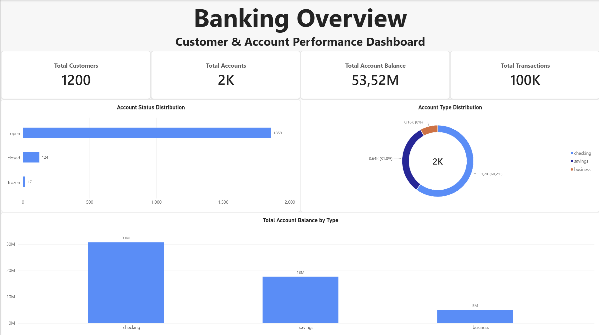
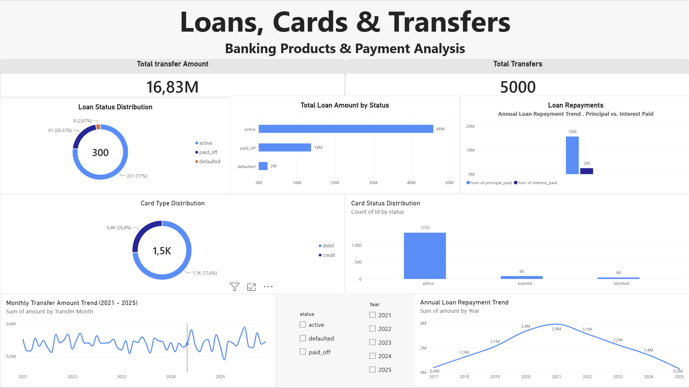
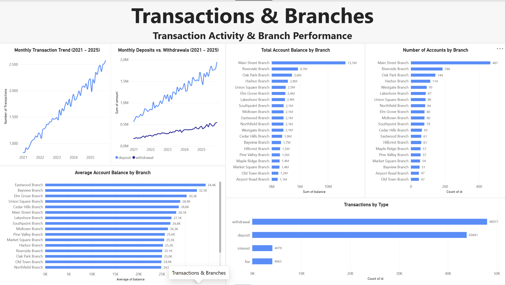

# Banking Customer & Transaction Analysis

## Project Overview

This project explores banking customer and transaction data using PostgreSQL, SQL, and Power BI. The goal was to understand customer account activity, transaction patterns, loan performance, and branch-level operations.

I used SQL to explore and validate the data, answer business questions, and identify patterns. I then developed an interactive Power BI dashboard to present the results.

## Tools Used

- **PostgreSQL / SQL** — Data exploration, validation, and analysis
- **Power BI** — Data modeling and dashboard development
- **VS Code** — SQL development
- **Git & GitHub** — Version control and documentation

## Dataset

The relational banking dataset contains 10 interconnected tables covering customers, accounts, transactions, transfers, loans, cards, branches, and addresses.

The analysis includes 1,200 customers, 2,000 accounts, 100,000 transactions, 300 loans, and 5,000 transfers.

## Analysis

The main areas explored were:

- Customer and account distribution
- Account balances and account status
- Monthly transaction trends and transaction types
- Loan performance and repayment activity
- Card usage and status distribution
- Transfers between accounts
- Branch-level account and balance analysis

Before the analysis, I checked for missing values, duplicates, inconsistent data, and invalid relationships between tables.

The SQL scripts are available in the `sql/` folder.

## Key Findings

- **472 customers** held more than one bank account.
- Checking accounts were the most common account type, with 1,204 accounts.
- Total account balances amounted to approximately **53.52 million**.
- Withdrawals (48,017) and deposits (43,841) accounted for most transactions.
- Of the 300 loans, 231 were active, 61 were paid off, and 8 were defaulted.
- The dataset contained 5,000 transfers totaling approximately **16.83 million**.

## Power BI Dashboard

I developed three dashboard pages to visualize the analysis.

### 1. Banking Overview

An overview of customer accounts, account balances, transaction volume, and account distributions.

### 2. Loans, Cards & Transfers

Analysis of loan status, repayments, card activity, and transfer trends.

### 3. Transactions & Branches

Monthly transaction activity, deposits and withdrawals, and branch-level performance.

## Project Files

- `sql/` — Database creation, data exploration, cleaning, and business analysis queries
- `powerbi/` — Power BI dashboard file
- `images/` — Dashboard screenshots

*Raw CSV files are not included in this repository.*

## Conclusion

This project helped me apply SQL and Power BI to a relational banking dataset, from data validation and analysis to dashboard development. It also gave me practical experience working with multiple related tables and translating SQL analysis into business-focused visualizations.